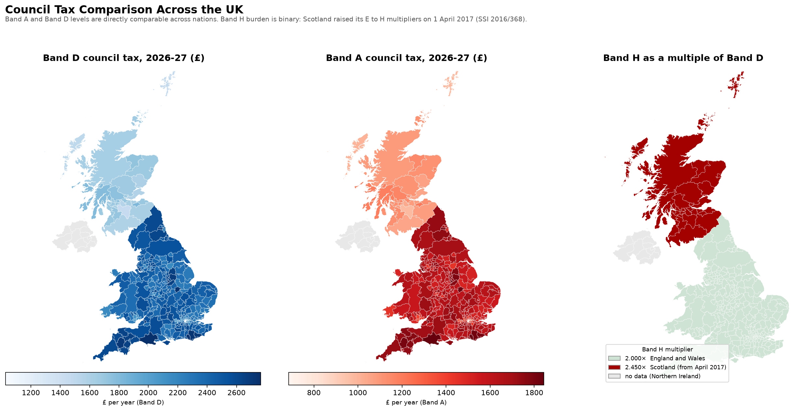
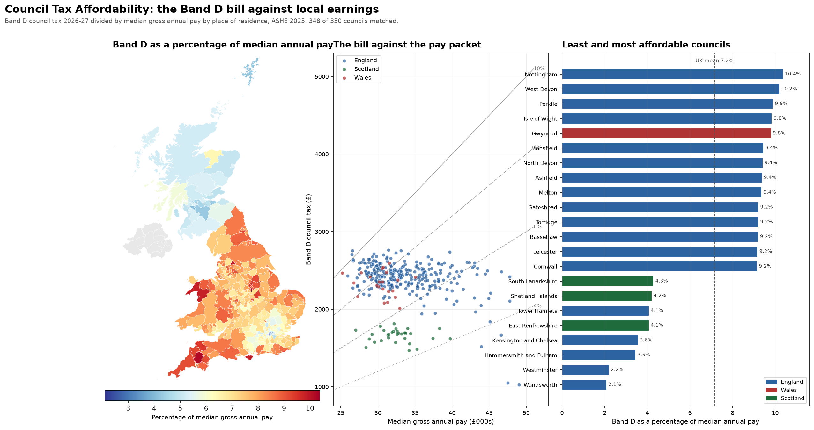
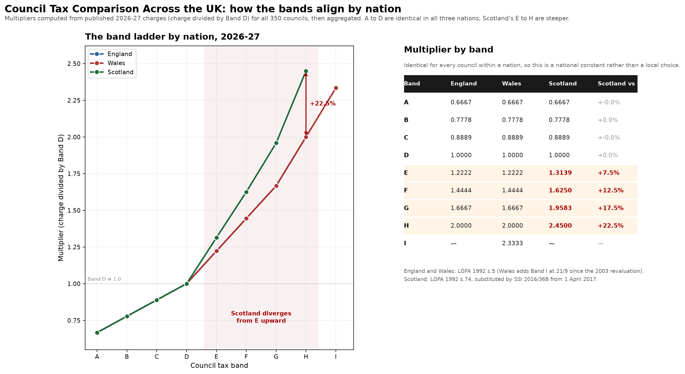
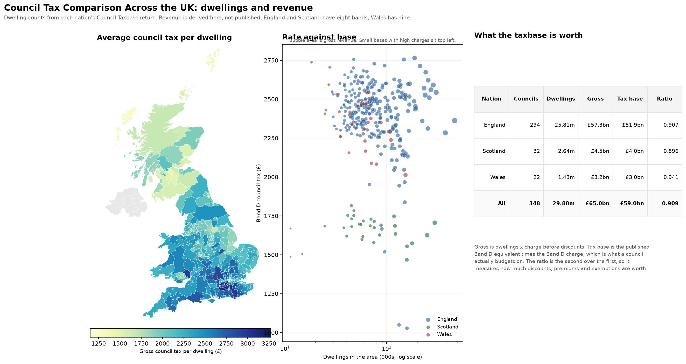
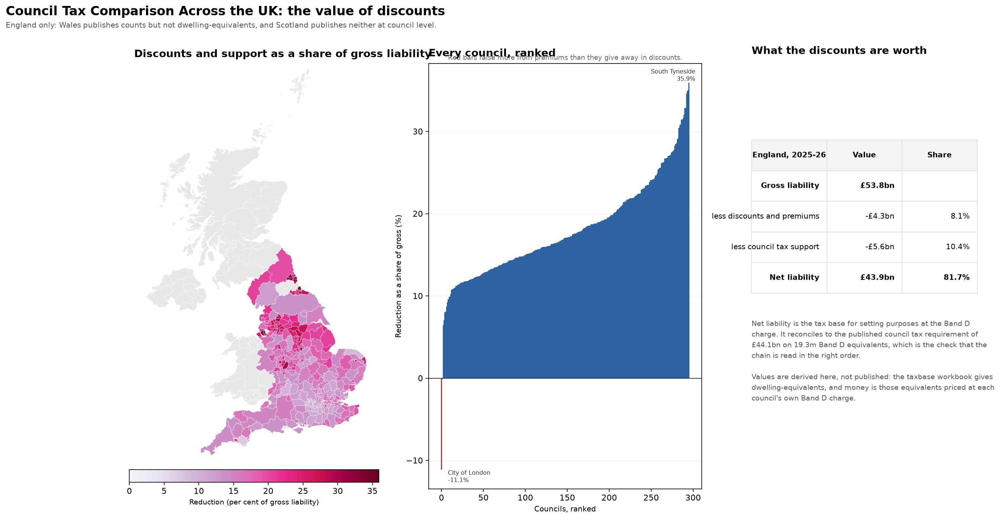
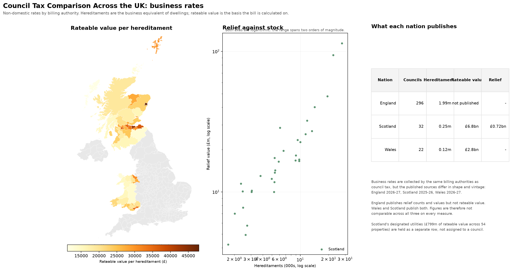

# UK Council Tax Comparison

Council tax by band for every local authority in Great Britain, aligned across
England, Wales and Scotland, with affordability measured against local earnings.

**350 councils · 8–9 bands each · 30 years of Band D history · 0 ratio violations**

**[Browse the interactive map and data table →](https://alessiomorteo.github.io/uk-council-tax/)**

---

## The headline findings

1. **This is three downloads, not 370 scrapers.** Band-by-band charges for all
   three nations come from one ODS workbook, one API CSV and one XLSX. The work
   is discovery and validation, not scraping.

2. **England's per-band data is buried.** The landing page advertises only Band D.
   The full A–H cross-tab lives in sheet 16 of a 17-sheet workbook (`Table_9`),
   unlinked from the index. Per-band England exists **only** for 2025-26 and
   2026-27 — every earlier "Table 9" is a different table.

3. **Scotland's multiplier ladder changed in 2017.** Bands E–H moved from
   11/9…18/9 to 473/360…882/360 under **SSI 2016/368** (in force 1 April 2017).
   Band H is now **2.450×** Band D against **2.000×** in England and Wales — a
   **22.5% premium**. Any pipeline using a single global ladder mis-states one era.

4. **The multiplier is a national constant.** Every council within a nation uses
   an identical ladder (max spread ~1e-5, i.e. rounding noise). It is not a local
   policy lever.

5. **Affordability varies 4.9×.** Band D costs **2.10%** of median pay in
   Wandsworth and **10.38%** in Nottingham. Absolute level and affordability are
   close to negatively correlated at the top of the distribution.

---

## Output

### Band levels and the multiplier



Band A and Band D are directly comparable across nations. The Band H panel is
binary by design: 318 councils sit at 2.000× and the 32 Scottish councils at
2.450×, with nothing in between.

### Affordability



The bill against the pay packet, with iso-burden lines at 4, 6, 8 and 10 per cent
of median pay. Councils above the 10 per cent line are the outliers.

### The band ladder by nation



Three lines that sit on top of each other until band E, where Scotland peels
away. A to D are identical everywhere.

### Dwellings and revenue



Council Taxbase adds the denominator the charges alone cannot supply: how many
dwellings sit in each band. Multiply by the charge and you get revenue.

The important finding is that **`dwellings × charge` is not what a council
collects**. It is gross liability before discounts, premiums and exemptions. The
published Band D equivalent tax base, multiplied by the Band D charge, is the
figure a council actually budgets on, and it is consistently lower:

| Nation | Dwellings | Gross | Budgeted | Ratio |
|---|---|---|---|---|
| England | 25.8m | £57.3bn | £51.9bn | 0.907 |
| Scotland | 2.64m | £4.5bn | £4.0bn | 0.896 |
| Wales | 1.43m | £3.2bn | £3.0bn | 0.941 |

The gap is the value of single-occupancy discounts, second-home premiums and
exemptions, worth roughly 6 to 11 per cent depending on nation. Both figures are
carried through the pipeline so the difference stays visible rather than being
silently baked in.

### What the discounts are worth



The taxbase workbook publishes dwelling-equivalents, not money. Money is
recoverable because a Band D equivalent is by definition one Band D charge, so
the shortfall at each stage can be priced at each council's own charge:

| England, 2025-26 | Value | Share of gross |
|---|---|---|
| Gross liability | £53.8bn | 100% |
| less discounts and premiums | −£4.3bn | 8.0% |
| less council tax support | −£5.6bn | 10.4% |
| **Net liability** | **£43.9bn** | **81.6%** |

That net figure is a hard check rather than an assertion: the published council
tax requirement for 2025-26 is **£44.1bn** on a tax base of **19.3m** Band D
equivalents, and the derived figures are 19,295,312 equivalents and £43.9bn.

The reduction ranges from **35.9% in South Tyneside to under 10% in parts of the
Home Counties**. Liverpool, Middlesbrough, Hartlepool and Knowsley all sit above
34%. In City of London and Isles of Scilly the figure is *negative*: the
second-homes premium raises more than discounts give away.

### Business rates



Non-domestic rates are collected by the same billing authorities, but the
published sources differ sharply in shape and vintage:

| | England | Wales | Scotland |
|---|---|---|---|
| Source | NNDR1 supplementary | StatsWales estimates | NDR reliefs publication |
| Year | 2026-27 | 2026-27 | 2025-26 |
| Hereditaments | 1,990,047 | 124,517 | 253,608 |
| Rateable value | **not published** | £2.79bn | £7.58bn |
| Relief value | £1.82bn (SBRR) | £0.28bn | £0.73bn |

England publishes the richest relief breakdown — 30 relief types across three
sheets — but **not rateable value**, so the map panel is grey for England. That
is a genuine gap in the release, not an omission here.

Scotland's **designated utilities** are held as their own row rather than
assigned to a council: 54 properties, £799m of rateable value, valued centrally.
Folding them into any council would overstate it.

Rateable value per hereditament ranges from **£11,147 in Na h-Eileanan Siar to
£47,950 in Aberdeen City** among the nations that publish it — a fourfold spread
in what the average business premises is worth.

### Interactive pages

`make pages` writes two self-contained HTML files to `output/pages/`:

| File | What it is |
|---|---|
| `map.html` | choropleth with five views and hover detail for every council |
| `table.html` | sortable, filterable table of all 348 councils |

Published at **<https://alessiomorteo.github.io/uk-council-tax/>**. `make site`
copies them into `docs/`, which is the GitHub Pages source directory, alongside a
landing page and the figures.

---

## Quick start

```bash
make all        # fetch -> parse -> align -> join -> figures -> pages -> site -> test
make site       # copy built pages into docs/ for GitHub Pages
make test       # validate the invariants only
make clean      # remove generated data, output and published site
```

Requires Python 3.10+ and `pandas odfpy openpyxl xlrd matplotlib`.

```bash
pip install -r requirements.txt
```

---

## Pipeline

```
src/
├── config.py                    paths, source URLs, statutory ladders, ONS recodes
├── validate.py                  assert every invariant; exits non-zero on failure
│
├── fetch/
│   └── download.py              download all raw sources -> data/raw/
│
├── build/
│   ├── parse.py                 raw -> tidy long CSVs -> data/processed/
│   ├── align.py                 attach multipliers, validate, nation ladder
│   └── join.py                  join boundaries + earnings, derive affordability
│
└── render/
    ├── figures.py               static PNGs -> output/figures/
    ├── pages.py                 interactive map and table -> output/pages/
    ├── site.py                  publish pages and figures -> docs/ (GitHub Pages)
    └── templates/
        ├── map.html             map page shell; GeoJSON inlined as __GEODATA__
        └── table.html           table page shell; rows inlined as __ROWDATA__
```

The three stage directories run in order: `fetch` then `build` then `render`.
`config.py` is shared by all of them and `validate.py` is run last by `make all`.

Each stage is independently runnable and idempotent. `download.py` skips files
already present; pass `--force` to refetch.

### Why the stages are separate

- **parse** is the only stage that knows about file formats (ODS quirks, the
  trailing `Notes` header label, footnote rows, name drift).
- **align** is the only stage that knows about statutory law, and it *fails the
  build* if any published charge disagrees with the multiplier.
- **join** is the only stage that knows about ONS codes and the recode map.
- **render** never touches raw data.

---

## Data

| File | Rows | Contents |
|---|---|---|
| `data/processed/uk_bands_2026-27.csv` | 9,246 | every council × band, long format |
| `data/processed/england_band_d_1993-2027.csv` | 39,656 | Band D history, 3 measures |
| `data/processed/wales_bands_1996-2027.csv` | 6,622 | 31 years × 10 bands |
| `data/processed/uk_bands_aligned_2026-27.csv` | 9,246 | + expected/actual multiplier |
| `data/processed/uk_council_tax_full.csv` | 348 | + boundaries, earnings, affordability |
| `data/processed/ratio_validation.csv` | — | per-nation per-band deviation report |

`data/raw/` is gitignored — it is ~9 MB of upstream files, all refetchable.

---

## Output

| Artefact | What it is |
|---|---|
| `output/figures/band_levels.png` | 3-panel choropleth: Band A, Band D, Band H multiplier |
| `output/figures/affordability.png` | choropleth + scatter + ranked bars |
| `output/figures/multipliers.png` | the ladder plotted, with the nation table |
| `output/figures/revenue.png` | revenue per dwelling, rate against base, nation totals |
| `output/figures/discounts.png` | exempt rate map, rate distributions, extremes |
| `output/figures/discount_values.png` | discounts priced in pounds, ranked, waterfall |
| `output/figures/business_rates.png` | rateable value map, relief against stock, nation totals |
| `output/pages/map.html` | interactive map, 6 views, hover detail |
| `output/pages/table.html` | sortable/filterable 348-row table, 21 columns |

The HTML pages are **self-contained** — GeoJSON and rows are inlined as JS
literals, because `fetch()` of a sibling file is blocked by CORS on `file://`.

---

## Validation

`src/validate.py` asserts, among other things:

- `charge / band_d == statutory_multiplier(nation, year, band)` on **every row**
  (8,564 checks, 0 violations, max deviation 1.2e-5)
- the ladder is uniform within each nation
- the Scotland ladder switches at exactly 2017-18
- England and Wales share A–H; Wales adds I; Scotland has no I
- coverage is 296 / 22 / 32 and the affordability file drops exactly the two
  ONS-suppressed councils

The ratio identity is the load-bearing check: it catches column-offset bugs that
spot checks miss.

---

## Caveats

- **Band D is not the same house in each nation.** 1991 values in England and
  Scotland, **2003** in Wales. Band D is £68,001–£88,000 (England),
  £45,001–£58,000 (Scotland), £91,001–£123,000 (Wales). Cross-nation *level*
  comparison is indicative, not like-for-like.
- **England's per-band figures are billing authorities only.** County and
  combined authorities levy precepts but do not bill; their precept is inside
  the area total.
- **Affordability compares a household bill with an individual wage.** Median pay
  is per job (ASHE, place of residence); council tax is per dwelling and assumes
  two adults. The ratio indicates relative pressure, not what a household pays
  after discounts, single-occupancy reduction or Council Tax Reduction.
- **Pay is 2025; council tax is 2026-27.** No uprating applied.
- **Two councils have no earnings figure.** City of London and Isles of Scilly
  are ONS-suppressed for small samples.
- **Northern Ireland is excluded.** No band system — domestic rates are rateable
  value × rate poundage.

---

## Sources

All Open Government Licence v3.0.

| Data | Source |
|---|---|
| England bands 2026-27 | MHCLG, *Council Tax levels set by local authorities in England 2026 to 2027*, Tables 1–9, sheet `Table_9` |
| England Band D 1993-2027 | MHCLG, *Band D Council Tax live table* |
| Wales bands 1996-2027 | Welsh Government / StatsWales API v2, dataset `1988b6af-2a9c-43b6-8939-83e6cceb3903` |
| Scotland bands 2026-27 | Scottish Government, *CTAS — Council Tax by Band 2026-27* |
| Earnings 2025 | ONS, *ASHE 2025*, Table 8.7a (place of residence by local authority) |
| Boundaries | ONS, *Local Authority Districts (December 2024) Boundaries UK BUC*. Contains OS data © Crown copyright and database right 2025 |
| Band definitions | LGFA 1992 s.5 (E&W) and s.74 (Scotland); SI 2003/3046 (Wales); SSI 2016/368 (Scotland) |

---

## Licence

Code: MIT. Data: Open Government Licence v3.0.
